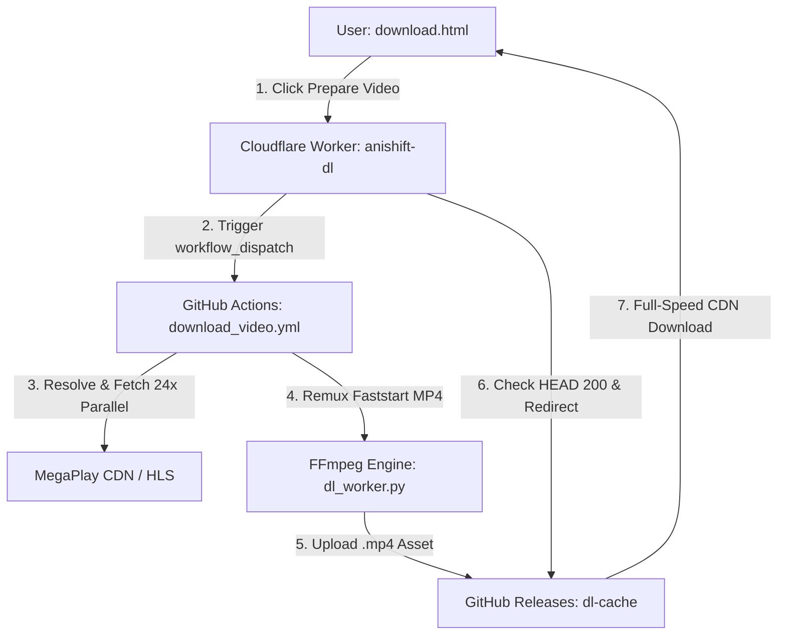

# ⚡ AniShift Video Download Cloud Worker

A high-performance, serverless MP4 packaging engine for AniShift.
Automatically resolves MegaPlay HLS streams, downloads `.ts` segments in parallel (24 threads), remuxes them via `FFmpeg` (`+faststart`) into genuine `.mp4` files, and uploads them to GitHub Releases for full-speed CDN delivery.

---

## 🏗️ Architecture

---

## 🔑 Cloudflare Worker Environment Variables

When you deploy `download_worker/worker.js` to Cloudflare Workers, go to:
**Settings ➔ Variables and Secrets ➔ Add** and configure:

| Variable Name | Value Description | Purpose |
| :--- | :--- | :--- |
| `GITHUB_TOKEN` | Personal Access Token (`github_pat_...`) with `Actions: Read & Write` | Triggers `download_video.yml` workflow dispatches. |
| `GITHUB_REPO` | Target GitHub repository (e.g., `vinothgeethika/as-hls-packager`) | Repository hosting the Cloud Worker & `dl-cache` Releases. |

---

## 🚀 GitHub Repository Setup

1. Create a new **Public** GitHub repository (e.g., `as-hls-packager`).
2. Push all files inside `cloud_worker/` (`dl_worker.py`, `requirements.txt`, `README.md`, and `.github/workflows/download_video.yml`) to the root of that repository.
3. No extra GitHub Secrets are required — the workflow uses the built-in `${{ secrets.GITHUB_TOKEN }}` with `contents: write` permission to upload `.mp4` assets to the `dl-cache` release.
